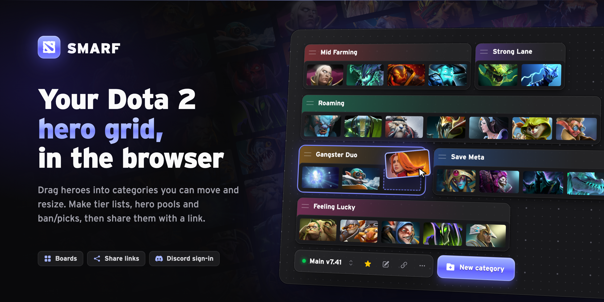

## Smarf

Smarf is a dota hero organizer on your browser

[App](https://smarf.kierb.com) / [Figma](https://www.figma.com/file/H1r4PLLf8UFnBconO1v66p/Smarf)

## Setup

See [SETUP.md](SETUP.md).

## UI

React 19, TypeScript 7, Vite 8, React Router 8, TanStack Query 5, Base UI, Tailwind CSS 4, and dnd-kit. From `ui/`:

```bash
npm test            # Vitest integration tests
npm run typecheck
npm run build       # production build to dist/
```

See [ui/AGENTS.md](ui/AGENTS.md) for how the UI is put together.

## Why?

This _recreates_ the in-game hero organizer for the web.

I'm an avid smurfer; I'm not really sorry. Unlike a lot of spamming boosters, I pick a wide variety of heroes and roles. Whenever I switch accounts, it's hard for me to pick some heroes I prefer per lane / style.

You might ask: why go all this trouble? I've had this idea for a couple of years. Now that I'm currently taking a break, I thought it would be fun to work on. This would also allow me to showcase the skills I've learnt from similar projects at my previous jobs. Lastly, it would be cool to apply some React patterns I tried a couple of times at my last work.

In the future, I think it'd be cool to allow folks to share their hero boards with their friends. What's even cooler would be to allow casual teams going into tournaments to organize their team's picks. Maybe.
