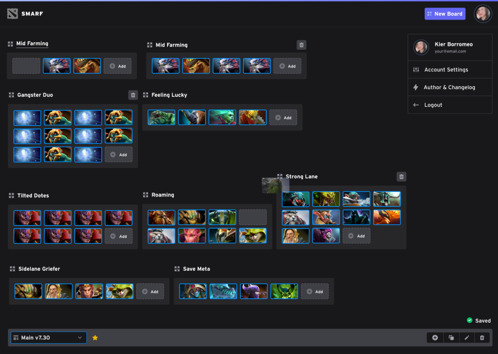

## Smarf

Smarf is a dota hero organizer on your browser

[App](https://smarf.kierb.com) / [Figma](https://www.figma.com/file/H1r4PLLf8UFnBconO1v66p/Smarf)

## Requirements

- PHP 8.1 and Composer 2 (via [Laravel Valet](https://laravel.com/docs/valet), pinned by `api/.valetrc`)
- Node 26 (via nvm, pinned by `ui/.nvmrc`)
- Docker with Compose v2 (for MySQL 8)
- Make

## Getting started

Install everything, start the database, run migrations, and write a Passport client into `ui/.env`:

```bash
make install
```

Then start the API and the UI in separate terminals:

```bash
make start:api
```

```bash
make start:web
```

The UI runs on port 13000 and the API on 13001, on all interfaces. The `.env` files point at `http://mbp:13000` and `http://mbp:13001` (a Tailscale MagicDNS name); change `APP_URL` in `api/.env` and `API_URL` in `ui/.env` if your machine has another name.

To create an admin user:

```bash
cd api && valet php --site=smarf artisan smarf:admin
```

## UI

React 19, TypeScript 7, Vite 8, React Router 8, TanStack Query 5, Base UI, styled-components 6, and dnd-kit. From `ui/`:

```bash
npm test            # Vitest integration tests
npm run typecheck
npm run build       # production build to dist/
```

See [ui/AGENTS.md](ui/AGENTS.md) for how the UI is put together and [ui/UPGRADE.md](ui/UPGRADE.md) for the 2026 upgrade.

## Why?

This _recreates_ the in-game hero organizer for the web.

I'm an avid smurfer; I'm not really sorry. Unlike a lot of spamming boosters, I pick a wide variety of heroes and roles. Whenever I switch accounts, it's hard for me to pick some heroes I prefer per lane / style.

You might ask: why go all this trouble? I've had this idea for a couple of years. Now that I'm currently taking a break, I thought it would be fun to work on. This would also allow me to showcase the skills I've learnt from similar projects at my previous jobs. Lastly, it would be cool to apply some React patterns I tried a couple of times at my last work.

In the future, I think it'd be cool to allow folks to share their hero boards with their friends. What's even cooler would be to allow casual teams going into tournaments to organize their team's picks. Maybe.
